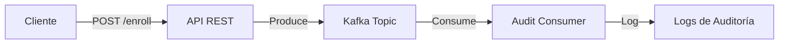

# Guía Rápida de Inicio - Sistema de Auditoría con Kafka

## Inicio Rápido (3 pasos)

### 1. Iniciar el sistema
```bash
cd app-enrollment-kafka
docker-compose up --build
```

**Espera hasta ver:**
```
enrollment-app | Started EnrollmentAuditApplication
```

### 2. Probar la API

**Windows (PowerShell):**
```powershell
.\test-api.ps1
```

**Linux/Mac (Bash):**
```bash
chmod +x test-api.sh
./test-api.sh
```

**O manualmente:**
```bash
# Ver estudiantes
curl http://localhost:8080/api/enrollment/students

# Crear matrícula
curl -X POST http://localhost:8080/api/enrollment/enroll \
  -H "Content-Type: application/json" \
  -d '{"studentId":"STU001","courseId":"CRS003"}'
```

### 3. Ver eventos en Kafka UI

Abrir en el navegador: http://localhost:8090

- Navegar a "Topics"
- Seleccionar `enrollment.created`
- Ver los mensajes y sus detalles

## URLs Importantes

| Servicio | URL | Descripción |
|----------|-----|-------------|
| API REST | http://localhost:8080 | Endpoints de la aplicación |
| Kafka UI | http://localhost:8090 | Interfaz gráfica de Kafka |
| Health | http://localhost:8080/actuator/health | Estado de la aplicación |

## Endpoints Principales

### GET /api/enrollment/students
Lista todos los estudiantes disponibles

### GET /api/enrollment/courses
Lista todos los cursos disponibles

### POST /api/enrollment/enroll
Crear una nueva matrícula
```json
{
  "studentId": "STU001",
  "courseId": "CRS003"
}
```

### POST /api/enrollment/{id}/cancel
Cancelar una matrícula
```json
{
  "reason": "Razón de la cancelación"
}
```

### POST /api/enrollment/{id}/change-course
Cambiar de curso
```json
{
  "newCourseId": "CRS005",
  "reason": "Razón del cambio"
}
```

### POST /api/enrollment/{id}/payment
Registrar un pago
```json
{
  "amount": 500.00,
  "currency": "USD",
  "paymentMethod": "Credit Card"
}
```

## Topics de Kafka

1. **enrollment.created** - Cuando se crea una matrícula
2. **enrollment.cancelled** - Cuando se cancela una matrícula
3. **course.changed** - Cuando se cambia de curso
4. **payment.completed** - Cuando se registra un pago

Cada topic tiene:
- 3 particiones
- Retención de 7 días
- Serialización JSON

## Ver Logs en Tiempo Real

```bash
# Logs de la aplicación
docker-compose logs -f enrollment-app

# Logs de Kafka
docker-compose logs -f kafka

# Todos los logs
docker-compose logs -f
```

## Detener el Sistema

```bash
# Detener servicios
docker-compose down

# Detener y limpiar todo (incluyendo datos)
docker-compose down -v
```

## Datos de Prueba

### Estudiantes (STU001 - STU010)
- STU001: Juan Pérez
- STU002: María García
- STU003: Carlos López
- ... (10 en total)

### Cursos (CRS001 - CRS010)
- CRS001: Introducción a Java
- CRS002: Spring Boot Avanzado
- CRS003: Microservicios con Kafka
- CRS004: Arquitectura de Software
- CRS005: Bases de Datos NoSQL
- ... (10 en total)

## Flujo de Trabajo Típico



1. Cliente hace una petición a la API
2. API valida y produce un evento a Kafka
3. Consumer lee el evento de Kafka
4. Consumer registra el evento en los logs
5. Evento queda almacenado en Kafka por 7 días

## Verificación del Sistema

### ¿Está todo corriendo?
```bash
docker-compose ps
```

Deberías ver 4 servicios `Up`:
- enrollment-zookeeper
- enrollment-kafka
- enrollment-kafka-ui
- enrollment-app

### ¿La aplicación está saludable?
```bash
curl http://localhost:8080/actuator/health
```

Respuesta esperada:
```json
{
  "status": "UP"
}
```

### ¿Los topics fueron creados?
Ir a http://localhost:8090 y verificar que existen 4 topics.

## Troubleshooting Rápido

### Error: Puerto 8080 en uso
```bash
# Windows
netstat -ano | findstr :8080
taskkill /PID <PID> /F

# Linux/Mac
lsof -ti:8080 | xargs kill -9
```

### Kafka no responde
```bash
# Reiniciar solo Kafka
docker-compose restart kafka

# Ver logs de Kafka
docker-compose logs kafka
```

### Reconstruir desde cero
```bash
docker-compose down -v
docker-compose up --build
```

## Ejemplo Completo

```bash
# 1. Crear matrícula
curl -X POST http://localhost:8080/api/enrollment/enroll \
  -H "Content-Type: application/json" \
  -d '{"studentId":"STU001","courseId":"CRS003"}' \
  | jq .

# Guardar el enrollmentId de la respuesta
ENROLL_ID="ENR-..."

# 2. Registrar pago
curl -X POST http://localhost:8080/api/enrollment/$ENROLL_ID/payment \
  -H "Content-Type: application/json" \
  -d '{"amount":500,"currency":"USD","paymentMethod":"Credit Card"}'

# 3. Ver en Kafka UI
# Abrir http://localhost:8090
# Topics > enrollment.created > Messages
# Topics > payment.completed > Messages

# 4. Ver logs
docker-compose logs enrollment-app | grep "AUDIT LOG"
```

## Próximos Pasos

1. Explora los eventos en Kafka UI
2. Revisa los logs de auditoría
3. Prueba diferentes combinaciones de estudiantes y cursos
4. Observa cómo se distribuyen los eventos en las particiones
5. Lee el README.md completo para más detalles

---

**Documentación completa:** Ver [README.md](README.md)
